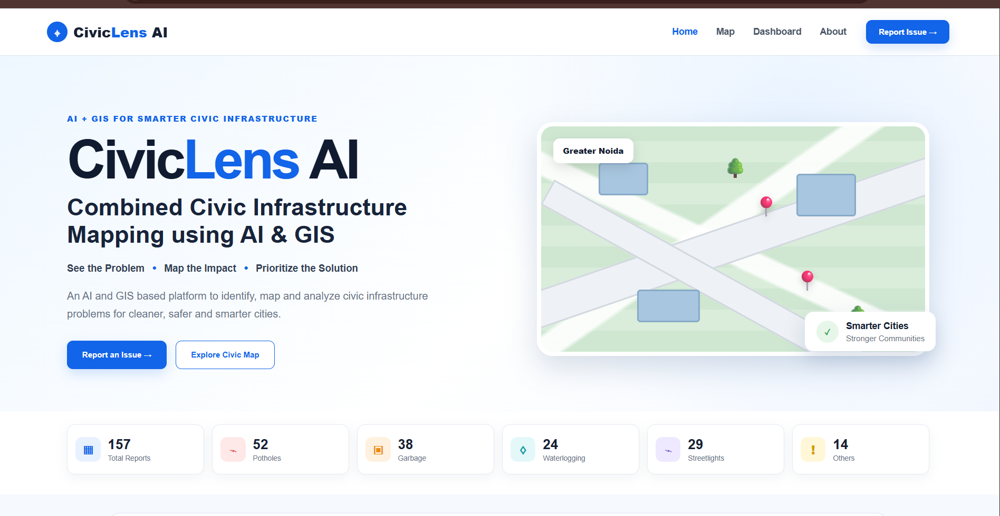
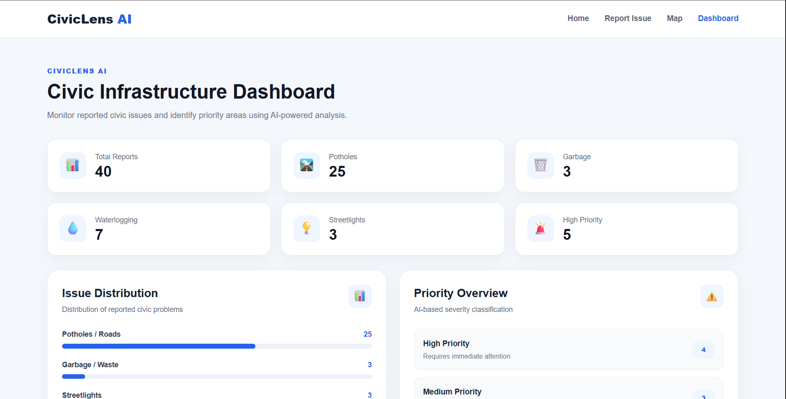

# CivicLens AI
### See the Problem • Map the Impact • Prioritize the Solution

CivicLens AI is an AI- and GIS-powered civic infrastructure reporting and decision-support prototype designed to help identify, map, analyze, and prioritize civic issues in selected urban areas of Greater Noida, Uttar Pradesh, India.

## Problem Statement

Urban areas face civic infrastructure problems such as potholes, garbage accumulation, waterlogging, and faulty streetlights. Information about these issues can be fragmented, making it difficult to understand their geographic distribution and identify areas that may need attention.

CivicLens AI combines image-based AI classification, geographic mapping, and data analytics to bring civic issue reports into one platform.

## Key Features

- **Smart Reporting:** Submit civic issues with an image, location, and description.
- **AI Classification:** Classify images into potholes, garbage, waterlogging, and streetlights.
- **Severity Assessment:** Display an estimated issue severity.
- **GIS Issue Map:** Visualize submitted reports geographically.
- **Interactive Dashboard:** Explore report counts, issue categories, and priority information.
- **Analytics:** View category distributions, severity summaries, trends, and potential hotspots.
- **Decision Support:** Help users understand which reported issues may deserve attention first.
- ## Application Screenshots

### Homepage


### Report Issue


### AI Analysis Result


### Civic Issue Map


### Dashboard


### Analytics


## Technology Stack

| Component | Technology |
|---|---|
| Frontend | HTML, CSS, JavaScript |
| Backend | Python, Flask |
| Database | SQLite |
| AI Model | MobileNetV3-based image classification |
| GIS Mapping | Leaflet.js, OpenStreetMap |
| Model Runtime | ONNX Runtime Web |
| Version Control | Git, GitHub |

## System Workflow

1. A user submits a civic issue report with an image and available location details.
2. The application processes the submitted report.
3. The AI model predicts an issue category.
4. The application displays the predicted category, confidence, and estimated severity.
5. After confirmation, report information is saved to the database.
6. The map, dashboard, and analytics present information from submitted reports.

## Supported Issue Categories

- Potholes
- Garbage
- Waterlogging
- Streetlights

## Project Structure

```text
CivicLens-AI/
├── backend/
│   ├── app.py
│   └── database.py
├── index.html
├── report.html
├── analysis.html
├── map.html
├── dashboard.html
├── analytics.html
├── style.css
├── script.js
├── report.css
├── report.js
├── analysis.css
├── analysis.js
├── map.css
├── map.js
├── dashboard.css
├── dashboard.js
├── analytics.css
├── analytics.js
├── requirements.txt
├── civiclens_model.onnx
├── .gitignore
└── README.md
```

*This is a summary of the main application files. Other local files may exist. Model files and uploaded images may require additional setup.*

## Running Locally

### Prerequisites

- Python 3.12 recommended
- pip
- A modern web browser

### 1. Clone the Repository

```bash
git clone https://github.com/chitranshshukla453-coder/CivicLens-AI.git
cd CivicLens-AI
```

### 2. Install Dependencies

```bash
pip install -r requirements.txt
```

### 3. Start the Backend

```bash
python backend/app.py
```

The local backend is configured to run at:

```text
http://127.0.0.1:5000
```

Keep the backend running while testing features that use the API.

### 4. Open the Frontend

Open `index.html` in a browser or use the VS Code Live Server extension. Features that call the backend require the Flask server to be running. AI inference may also require the model file and compatible browser runtime.

## Current Scope and Limitations

CivicLens AI is a prototype for civic issue reporting, image classification, mapping, and analytics. AI predictions, severity labels, and priority scores are estimates; they should not be treated as verified assessments or used as the sole basis for real-world decisions.

The geographic scope currently focuses on selected urban areas of Greater Noida. Accuracy and usefulness depend on image quality, model performance, report completeness, and available location data.

## Future Improvements

- Improve classification accuracy and add duplicate-report detection.
- Support Hindi and other languages.
- Improve geographic hotspot analysis.
- Explore predictive identification of infrastructure deterioration.
- Integrate with civic authority workflows.
- Improve mobile usability and accessibility.

## Social Impact

CivicLens AI aims to help citizens communicate local infrastructure issues and help communities and civic authorities better understand where reported problems occur and which issues may need attention.

## Hackathon Theme

**AI, GIS & Emerging Technologies — Technology for Social Transformation**

## License

This project is licensed under the **MIT License**. See the [LICENSE](LICENSE) file for details.
